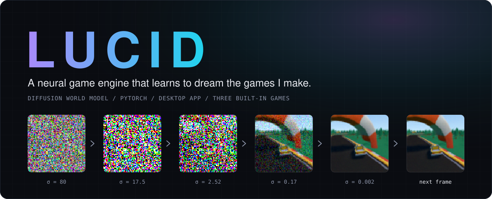
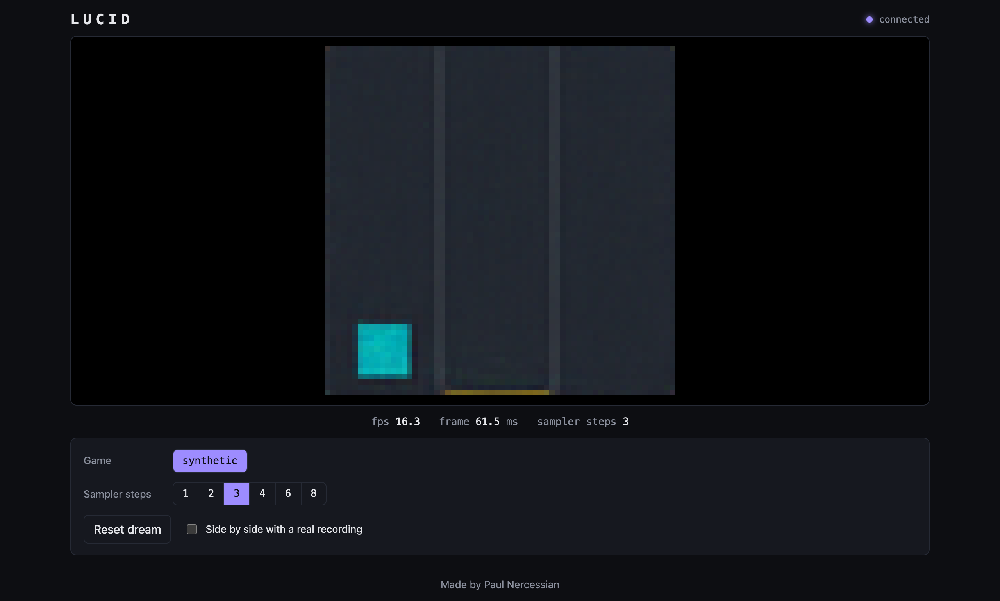
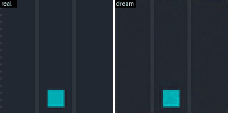
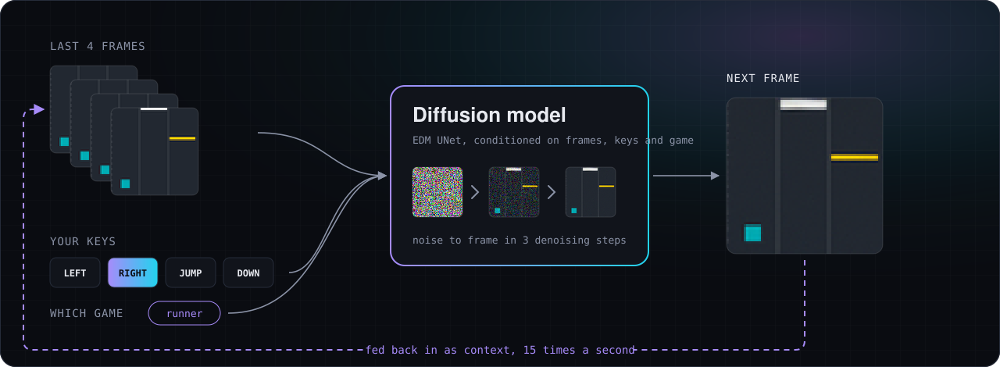
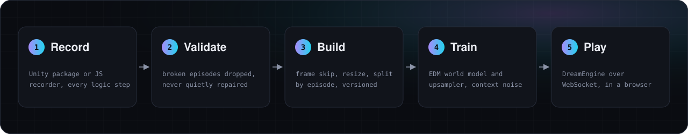
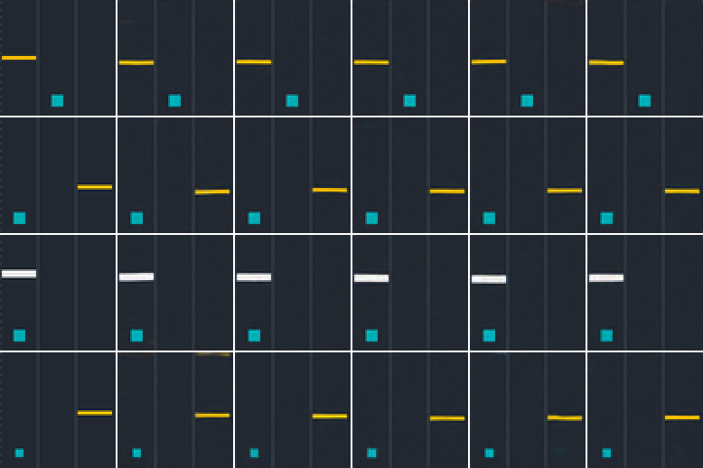

<p align="center">
  
</p>

<p align="center">
  <a href="https://github.com/Bouwles/lucid/actions/workflows/ci.yml"></a>
  
  
  
  
</p>

<p align="center">
  <a href="#see-it-run">See it run</a> ·
  <a href="#how-it-works">How it works</a> ·
  <a href="#what-didnt-work-yet">What didn't work</a> ·
  <a href="#run-it-yourself">Run it yourself</a> ·
  <a href="#progress">Progress</a>
</p>

---

LUCID turns a game into a neural network. You record people playing, and it learns to **imagine** the game one frame at a time, fast enough that you can play the imagination instead of the real thing. There's no game engine, no physics code and no level data in the loop. A diffusion model looks at the last few frames and the keys you're pressing, and dreams up what comes next.

The strip at the top is a single real prediction. The model starts from pure noise on the left and denoises it into the next frame on the right, guided by the frames before it and the current input.

I'm building it to learn several of my own games in one model: an endless runner, a platformer and a 3D game. You'll be able to switch between them, or blend them, live in the browser.

> **Where it's at:** the whole engine is built and tested end to end. That covers the Unity recorder, the dataset pipeline, the diffusion world model, evaluation, the real-time engine and the browser demo. Until I record my Unity runner, every picture below comes from a small **synthetic lane game** I wrote to test the pipeline. It is not one of my games, and none of its numbers count as results.

## See it run

<p align="center">
  
</p>
<p align="center"><sub>The browser demo running the synthetic test model live. Every frame on screen was generated by the network. That's 16 frames per second over WebSocket on my MacBook's CPU. On its GPU, the model alone takes 11 ms per frame.</sub></p>

<p align="center">
  
</p>
<p align="center"><sub>Left: the real synthetic game. Right: the dream, driven by the same recorded key presses. This is the first of four random test clips, not a hand-picked best case. The dream keeps the look, the scrolling and the player, and stays stable, but it invents its own obstacles and only sometimes follows the lane changes.</sub></p>

## How it works

<p align="center">
  
</p>

Every step, the model gets the last 4 frames, the buttons being held and which game it is. It denoises a fresh frame from pure noise in about 3 steps. That frame goes back into the context and the loop runs again, 15 times a second. Run it long enough and the model is playing the game in its head.

The hard part is **drift**. Each dreamed frame is a little wrong, and feeding wrong frames back in makes the next ones more wrong, until it all melts into mush. Three things fight it:

- **Diffusion instead of plain regression.** A model trained on mean squared error predicts the average of every possible future, so an obstacle that might go left or right becomes a grey smear in both places. Diffusion commits to one sharp future. The repo includes an MSE baseline to show the difference.
- **Context-noise augmentation**, the trick from GameNGen. In training I add random noise to the context frames and tell the model how much. It learns to clean up imperfect context instead of amplifying the errors. There's a ready-made ablation config that switches it off for comparison.
- **EDM preconditioning** (Karras et al.). It keeps the network well behaved at every noise level, so a handful of sampling steps is enough to hit real-time speeds.

### From key press to dream

<p align="center">
  
</p>

1. **Record.** A drop-in Unity package saves every logic step's frame, the buttons pressed and a few state labels. A scripted autopilot can play for hours, mixing careful play, sloppy play, random button mashing and idling, so the model sees mistakes and deaths too. There's a JavaScript recorder for browser games as well.
2. **Validate.** Every episode is checked: frame counts, step order, resolution, frozen frames and illegal buttons. Broken episodes are dropped and reported, never quietly patched.
3. **Build.** Frames are resized and letterboxed, and four logic steps become one training step. Episodes are split into train, validation and test by a hash of their id, so recording more data never leaks old test episodes into training.
4. **Train.** One training loop handles the baseline, the world model and the upsampler, with an EMA of the weights, resumable checkpoints, an action grid and a free-running rollout GIF at every validation.
5. **Play.** `DreamEngine` wraps the model behind `reset()` and `step(action)`. A FastAPI WebSocket server streams lossless WebP frames to the browser, and there's also a local pygame window and an ONNX export for running it fully in the browser on WebGPU.

### Measuring it honestly

Pretty clips are easy to cherry-pick, so the evaluation script measures things that are hard to fake:

| What | How |
|---|---|
| Image quality | PSNR, SSIM and LPIPS, one step ahead and at rollout steps 1, 2, 4 ... 64 |
| Long-run stability | Sharpness and colour statistics over a 2,000-step dream, and how long they stay inside the range of real footage |
| Does it obey the controls? | Small CNN probes trained on real frames read the lane and jump state from dreamed frames, after holding each key |
| Does it look real? | A classifier trained to tell real from dreamed frames. 50% means it can't. |
| Speed | Milliseconds per frame on the serving machine |

It also saves a failure gallery: the rollouts that broke down fastest, so I can look at how they failed.

## What didn't work (yet)

<p align="center">
  
</p>
<p align="center"><sub>The action grid from training. Each row is a starting point, the first column is the last real frame, and the other columns are the next frame predicted for no key, left, right, down and jump.</sub></p>

- **The dream doesn't obey the controls well yet.** After 35 minutes of training on 324 synthetic episodes, image quality is good: one-step LPIPS is 0.031, and all 8 test dreams stayed stable for 1,000 steps. Control is the weak part. The probes say a held left moves the dreamed player 38% of the time, right 23% and jump 11%, while the real game scores 100% on every test. The action grid above shows the same thing: the columns barely differ.
- **The data isn't the problem.** I checked: all 1,849 lane changes in the training data line up with the key pressed one step earlier. My guess is that lane changes are only 3.5% of frames, and a held key only moves you once, so the model has to learn "just pressed", not "pressed". Next I'll try longer training, classifier-free guidance on the actions, and weighting the loss toward frames where something changes.
- **Phantom players.** An earlier 10-minute checkpoint dreamed two player squares side by side, which the real game can never show. It went away with more data and training.
- **It still doesn't fool a classifier.** A small CNN tells real frames from dreamed ones 92% of the time (50% would mean it can't tell).
- **My controllability check was unfair at first.** It counted a jump as "ignored" even when the player was already in mid-air, where the real game ignores it too. Once real and dreamed cases were compared like for like, the real game scored 100% as it should.
- **YAML read `3e-4` as text.** It needs a decimal point to count as a number, so `--set train.lr=3e-4` silently became a string. Overrides now parse numbers properly.

The results table in [docs/results.md](docs/results.md) stays empty until there are numbers from my own games.

## Progress

- [x] Stage 0: the full pipeline, tested end to end on a synthetic game
- [ ] Stage 1: a playable dream of my Unity endless runner
- [ ] Stage 2: one model, two games, with live switching
- [ ] Stage 3: a 3D game
- [ ] Stage 4: high-resolution output from the diffusion upsampler
- [ ] Stage 5: game blending, and a "dream mode" where a policy plays inside the dream
- [ ] Stage 6: an agent that learns to play only inside the dream, then plays the real game

## Run it yourself

```bash
git clone https://github.com/Bouwles/lucid && cd lucid
python -m venv .venv && source .venv/bin/activate
pip install -e ".[dev,play]"
pytest -q                                   # all CPU tests, about 30 seconds
```

The whole loop on the synthetic game takes about 15 minutes on an Apple Silicon or CUDA laptop:

```bash
python scripts/make_fixture.py --episodes 400                      # record synthetic episodes
python scripts/build_dataset.py --config configs/data/synthetic.yaml
python scripts/train.py --config configs/train/smoke_synthetic.yaml --set train.max_steps=4000
python scripts/serve.py --checkpoint runs/<run>/best.pt           # then open http://localhost:8000
```

With real recordings, the same commands run on your own game:

```bash
python scripts/build_dataset.py --config configs/data/runner_v1.yaml
python scripts/train.py --config configs/train/small.yaml
python scripts/train_probes.py --config configs/train/small.yaml
python scripts/evaluate.py --checkpoint runs/<run>/best.pt --probes data/processed/runner_v1/probes.pt
python scripts/play_local.py --checkpoint runs/<run>/best.pt       # keyboard, in a window
```

`python scripts/check_env.py` reports your hardware. CUDA, Apple Silicon (MPS) and CPU all work, with bf16 where the device supports it.

## Use the recorder in your own Unity game

The recorder is a Unity package. Add it from git in the Package Manager:

```
https://github.com/Bouwles/lucid.git?path=/recorder/unity/com.paulnercessian.lucid-recorder
```

Implement two small interfaces, one that applies an action to your game and one that reports a few state labels, and it records LUCID training data. It reads frames back from the GPU asynchronously, writes on a background thread, and pauses the game instead of dropping a frame if the disk can't keep up. A determinism test replays an episode and reports the first step where anything differs. Details: [recorder/unity](recorder/unity/com.paulnercessian.lucid-recorder/README.md). The file format is in [docs/formats.md](docs/formats.md).

## What's in the repo

| Path | What |
|---|---|
| `lucid/data` | raw format, validation, dataset building, PyTorch datasets, stats |
| `lucid/models` | conditioned UNet, EDM world model, sampler, MSE baseline, upsampler, autoencoder |
| `lucid/train` | training loop, EMA, checkpoints, logging |
| `lucid/eval` | metrics, rollouts, probes, controllability, stability, real-vs-dream classifier, report |
| `lucid/play` | `DreamEngine`, WebSocket server, ONNX export |
| `recorder/` | Unity package and browser-game recorder |
| `web/` | the browser demo (plain JS, no build step) |
| `configs/` | games, dataset, model and training configs |
| `docs/` | [concepts](docs/concepts.md), [decisions](docs/decisions.md), [formats](docs/formats.md), [references](docs/references.md), [devlog](docs/devlog.md) |

## Built on

LUCID stands on research I learned a lot from: GameNGen (diffusion models as real-time game engines), DIAMOND (diffusion world models), EDM (the diffusion formulation used here), Genie, and Ha and Schmidhuber's World Models. Full references are in [docs/references.md](docs/references.md).

All training data comes from games I made. No other games or assets are used.

---

<p align="center">Made by Paul Nercessian · <a href="https://github.com/Bouwles">github.com/Bouwles</a></p>
