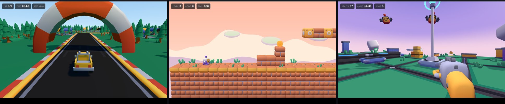
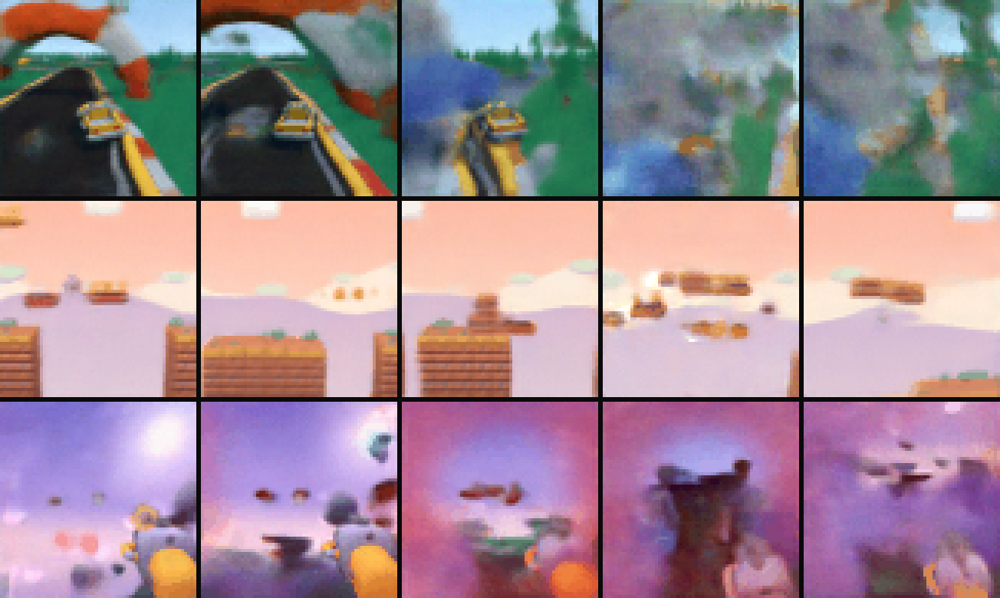

<p align="center">
  
</p>

<p align="center">
  <a href="https://github.com/Bouwles/lucid/actions/workflows/ci.yml"></a>
  
  
  
  
</p>

<p align="center">
  <a href="#see-it-run">See it run</a> ·
  <a href="#how-it-works">How it works</a> ·
  <a href="#what-didnt-work-yet">What didn't work</a> ·
  <a href="#run-it-yourself">Run it yourself</a> ·
  <a href="#progress">Progress</a>
</p>

---

LUCID turns a game into a neural network. You record people playing, and it learns to **imagine** the game one frame at a time, fast enough that you can play the imagination instead of the real thing. There's no game engine, no physics code and no level data in the loop. A diffusion model looks at the last few frames and the keys you're pressing, and dreams up what comes next.

The strip at the top is a single real prediction. The model starts from pure noise on the left and denoises it into the next frame on the right, guided by the frames before it and the current input.

LUCID is a desktop app with three games of its own: **Drift Kit** (a low-poly racer), **Bramble** (a side-scrolling platformer) and **Outpost** (a first-person arena shooter). You can play each real game, then play its dream: the same game imagined by the network, with no game engine running.

> **Where it's at:** the app, the three games and a first dream of each are done. Each dream was trained for about 30 minutes on my laptop, so they look right and stay stable, but they follow the controls only part of the time (numbers below). That's the main thing I'm working on.

## See it run

<p align="center">
  
</p>
<p align="center"><sub>The three real games, running inside the app. Art and sound are Kenney's CC0 starter kits (<a href="games/CREDITS.md">credits</a>).</sub></p>

<p align="center">
  
</p>
<p align="center"><sub>Their dreams. Every frame here was generated by the network from the previous frames and the keys held, at 64x64. Each row is one dream from the hover clips in the app, not picked for being the best.</sub></p>

The dreams run at about 12 frames per second on my MacBook's CPU (ONNX Runtime, 3 denoising steps with classifier-free guidance).

| | Drift Kit | Bramble | Outpost |
|---|---|---|---|
| Training | 4,075 steps, 30 min | 4,801 steps, 38 min | 4,040 steps, 30 min |
| Recorded play | 167,519 logic ticks | 213,512 logic ticks | 187,841 logic ticks |
| Holding a key moves the dream the right way | accelerate 64%, steer 29 to 34% | run left 59%, run right 64% | not reliable yet (see below) |
| Same check on real footage (the ceiling) | 85 to 96% | 73 to 93% | 57 to 77% |
| Dream speed in the app | 12 FPS | 12 FPS | 12 FPS |

The control numbers come from an inverse dynamics model: a small network trained on real footage to tell which buttons were held between two frames. I hold one key in the dream and ask it what it sees. "The ceiling" is how well it reads the real game, so a dream can't score much above that.

## How it works

<p align="center">
  
</p>

Every step, the model gets the last 4 frames, the buttons being held and which game it is. It denoises a fresh frame from pure noise in about 3 steps. That frame goes back into the context and the loop runs again, 15 times a second. Run it long enough and the model is playing the game in its head.

The hard part is **drift**. Each dreamed frame is a little wrong, and feeding wrong frames back in makes the next ones more wrong, until it all melts into mush. Three things fight it:

- **Diffusion instead of plain regression.** A model trained on mean squared error predicts the average of every possible future, so an obstacle that might go left or right becomes a grey smear in both places. Diffusion commits to one sharp future. The repo includes an MSE baseline to show the difference.
- **Context-noise augmentation**, the trick from GameNGen. In training I add random noise to the context frames and tell the model how much. It learns to clean up imperfect context instead of amplifying the errors. There's a ready-made ablation config that switches it off for comparison.
- **EDM preconditioning** (Karras et al.). It keeps the network well behaved at every noise level, so a handful of sampling steps is enough to hit real-time speeds.

### From key press to dream

<p align="center">
  
</p>

1. **Record.** A drop-in Unity package saves every logic step's frame, the buttons pressed and a few state labels. A scripted autopilot can play for hours, mixing careful play, sloppy play, random button mashing and idling, so the model sees mistakes and deaths too. There's a JavaScript recorder for browser games as well.
2. **Validate.** Every episode is checked: frame counts, step order, resolution, frozen frames and illegal buttons. Broken episodes are dropped and reported, never quietly patched.
3. **Build.** Frames are resized and letterboxed, and four logic steps become one training step. Episodes are split into train, validation and test by a hash of their id, so recording more data never leaks old test episodes into training.
4. **Train.** One training loop handles the baseline, the world model and the upsampler, with an EMA of the weights, resumable checkpoints, an action grid and a free-running rollout GIF at every validation.
5. **Play.** `DreamEngine` wraps the model behind `reset()` and `step(action)`. A FastAPI WebSocket server streams lossless WebP frames to the browser, and there's also a local pygame window and an ONNX export for running it fully in the browser on WebGPU.

### Measuring it honestly

Pretty clips are easy to cherry-pick, so the evaluation script measures things that are hard to fake:

| What | How |
|---|---|
| Image quality | PSNR, SSIM and LPIPS, one step ahead and at rollout steps 1, 2, 4 ... 64 |
| Long-run stability | Sharpness and colour statistics over a 2,000-step dream, and how long they stay inside the range of real footage |
| Does it obey the controls? | Small CNN probes trained on real frames read the lane and jump state from dreamed frames, after holding each key |
| Does it look real? | A classifier trained to tell real from dreamed frames. 50% means it can't. |
| Speed | Milliseconds per frame on the serving machine |

It also saves a failure gallery: the rollouts that broke down fastest, so I can look at how they failed.

## What didn't work (yet)

- **For a long time the dreams ignored the controls completely.** The model gets a conditioning vector that adds up the game, the noise level and the action. At the start of training, the game part was about ten times bigger than the action part, and the difference between "left" and "right" was about 1% of the whole. In my first trained model, switching left to right changed the output by 0.0001, while a fresh noise draw changed it by 0.01 to 0.07. Normalising each part before adding them up, and also feeding the keys in as extra image channels, fixed most of it: Bramble's "run left" went from 33% to 59% with guidance.
- **Weighting the loss toward moving pixels didn't help.** It sounded right (that's where actions show up) and made left and right worse on the test game, so it's switched off.
- **Two denoising steps turn these dreams into noise.** The schedule jumps from noise level 80 straight to 0.002, a level the model almost never saw in training. Three steps look fine. That costs speed: 12 FPS instead of about 15.
- **Steering and braking are weak.** The Drift Kit dream mostly drives along the track by itself, because the autopilot it learned from always does. Brake (11%) and drift (21%) barely register. Jump in Bramble (10%) is the same story.
- **Outpost's numbers can't be trusted yet.** Even on real Outpost footage the inverse dynamics model only reads the keys 57 to 77% of the time, because a first-person camera changes everything at once. I need a better way to measure it.
- **It doesn't fool a classifier.** On the earlier test game, a small CNN told real frames from dreamed ones 92% of the time (50% would mean it can't tell).
- Smaller bugs worth remembering: YAML reads `3e-4` as text, Chrome's `/json/new` cuts an unencoded URL at the first `&`, and a stuck-in-mid-air jump isn't the dream's fault.

The table in [docs/results.md](docs/results.md) is for numbers that have been re-checked against the run logs; it fills in as the dreams get longer training.

## Progress

- [x] Stage 0: the full pipeline, tested end to end on a synthetic game
- [x] The desktop app (Tauri), with the engine built in and no terminal needed
- [x] Three built-in games: Drift Kit, Bramble and Outpost
- [x] A first dream of each game that responds to some of the controls
- [ ] Dreams that respond to every control (longer training, better data)
- [ ] One model for all three games, with live switching
- [ ] Installers for macOS, Windows and Linux built automatically
- [ ] Stage 4: high-resolution output from the diffusion upsampler
- [ ] Stage 5: game blending, and a "dream mode" where a policy plays inside the dream
- [ ] Stage 6: an agent that learns to play only inside the dream, then plays the real game

## Try the app

Installers for macOS, Windows and Linux are built by GitHub Actions and attached to [Releases](https://github.com/Bouwles/lucid/releases). They aren't signed yet, so the first time on macOS right-click the app and choose Open, and on Windows choose More info, then Run anyway.

To build it yourself on a Mac (Node 24, Rust and the repo's Python environment):

```bash
.venv/bin/python engine/build_sidecar.py                                   # the engine, without PyTorch
.venv/bin/python scripts/fetch_dream_pack.py --list app/src-tauri/resources/models/packs.json
cd app && npm install && npx tauri build                                    # LUCID.app and a .dmg
```

More detail, including running it in development, is in [docs/app.md](docs/app.md).

## Run it yourself

```bash
git clone https://github.com/Bouwles/lucid && cd lucid
python -m venv .venv && source .venv/bin/activate
pip install -e ".[dev,play]"
pytest -q                                   # all CPU tests, about 30 seconds
```

The whole loop on the synthetic game takes about 15 minutes on an Apple Silicon or CUDA laptop:

```bash
python scripts/make_fixture.py --episodes 400                      # record synthetic episodes
python scripts/build_dataset.py --config configs/data/synthetic.yaml
python scripts/train.py --config configs/train/smoke_synthetic.yaml --set train.max_steps=4000
python scripts/serve.py --checkpoint runs/<run>/best.pt           # then open http://localhost:8000
```

With real recordings, the same commands run on your own game:

```bash
python scripts/build_dataset.py --config configs/data/runner_v1.yaml
python scripts/train.py --config configs/train/small.yaml
python scripts/train_probes.py --config configs/train/small.yaml
python scripts/evaluate.py --checkpoint runs/<run>/best.pt --probes data/processed/runner_v1/probes.pt
python scripts/play_local.py --checkpoint runs/<run>/best.pt       # keyboard, in a window
```

`python scripts/check_env.py` reports your hardware. CUDA, Apple Silicon (MPS) and CPU all work, with bf16 where the device supports it.

## Use the recorder in your own Unity game

The recorder is a Unity package. Add it from git in the Package Manager:

```
https://github.com/Bouwles/lucid.git?path=/recorder/unity/com.paulnercessian.lucid-recorder
```

Implement two small interfaces, one that applies an action to your game and one that reports a few state labels, and it records LUCID training data. It reads frames back from the GPU asynchronously, writes on a background thread, and pauses the game instead of dropping a frame if the disk can't keep up. A determinism test replays an episode and reports the first step where anything differs. Details: [recorder/unity](recorder/unity/com.paulnercessian.lucid-recorder/README.md). The file format is in [docs/formats.md](docs/formats.md).

## What's in the repo

| Path | What |
|---|---|
| `lucid/data` | raw format, validation, dataset building, PyTorch datasets, stats |
| `lucid/models` | conditioned UNet, EDM world model, sampler, MSE baseline, upsampler, autoencoder |
| `lucid/train` | training loop, EMA, checkpoints, logging |
| `lucid/eval` | metrics, rollouts, probes, controllability, stability, real-vs-dream classifier, report |
| `lucid/play` | `DreamEngine`, WebSocket server, ONNX export |
| `recorder/` | Unity package and browser-game recorder |
| `web/` | the browser demo (plain JS, no build step) |
| `configs/` | games, dataset, model and training configs |
| `docs/` | [concepts](docs/concepts.md), [decisions](docs/decisions.md), [formats](docs/formats.md), [references](docs/references.md), [devlog](docs/devlog.md) |

## Built on

LUCID stands on research I learned a lot from: GameNGen (diffusion models as real-time game engines), DIAMOND (diffusion world models), EDM (the diffusion formulation used here), Genie, and Ha and Schmidhuber's World Models. Full references are in [docs/references.md](docs/references.md).

All training data comes from games I made. No other games or assets are used.

---

<p align="center">Made by Paul Nercessian · <a href="https://github.com/Bouwles">github.com/Bouwles</a></p>
